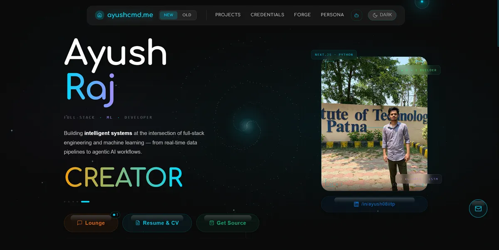
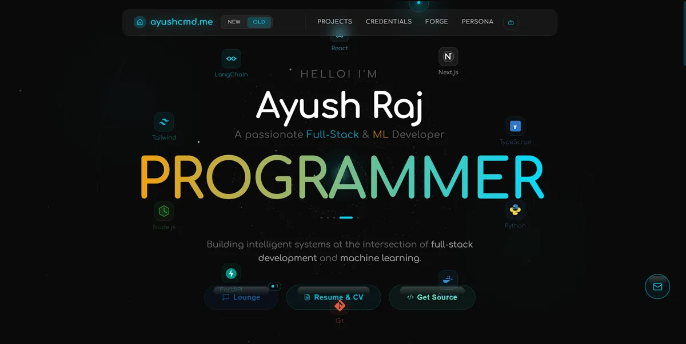

<div align="center">


# Portfolio — Public Free Edition

**A futuristic developer portfolio** built with Next.js 15, TypeScript, TailwindCSS, Redis, and AI integrations — engineered with a production-style architecture and deployable.

<br/>

[](https://nextjs.org)
[](https://react.dev)
[](https://www.typescriptlang.org)
[](https://tailwindcss.com)
[](https://upstash.com)
[](https://groq.com)


[](#license)
[](#)

<br/>

<a href="#-live-features"><b>Features</b></a> ·
<a href="#-tech-stack"><b>Tech Stack</b></a> ·
<a href="#-route-structure"><b>Routes</b></a> ·
<a href="#-repository-structure"><b>Structure</b></a> ·
<a href="#-get-the-full-version"><b>Pricing</b></a> ·
<a href="#-deployment"><b>Deploy</b></a>


<br/>

**🆕 Latest Build (New Design)**



<br/>

**Previous Build (Old Design)**



<br/>

</div>

## Overview

This repository is the **public showcase edition** of my personal portfolio platform.

It demonstrates:

<table>
<tr>
<td width="50%" valign="top">

✦ Modern frontend engineering
✦ AI-powered experiences
✦ Real-time communication systems

</td>
<td width="50%" valign="top">

✦ Advanced visual effects
✦ Scalable folder architecture
✦ Serverless deployment workflows

</td>
</tr>
</table>

Built to run efficiently on the **Vercel Hobby (Free) Tier** while still delivering premium interactions and performance.


## ✦ Live Features

<table>
<tr>
<td width="50%" valign="top">

### 👾 KIRO AI Assistant
AI-powered portfolio assistant built on:
- Groq API — LLaMA 3.3 70B
- Edge Runtime streaming responses
- Real-time, ultra-fast inference
- Futuristic chat interface

</td>
<td width="50%" valign="top">

### 💬 Visitor Lounge
Real-time multi-user chat system using:
- Server-Sent Events (SSE)
- Upstash Redis
- Live message broadcasting
- Concurrent visitor support

</td>
</tr>
<tr>
<td width="50%" valign="top">

### 🌐 3D Tech Globe
Custom Canvas2D animated globe featuring:
- Orbiting technology icons
- Glow effects & dynamic motion
- Zero Three.js — lightweight rendering
- Small bundle, high compatibility

</td>
<td width="50%" valign="top">

### 🌌 Galaxy Background System
Custom visual engine containing:
- Particle field & spiral galaxy arms
- Ripple interactions
- Shooting stars & glow animation
- Cinematic landing experience

</td>
</tr>
<tr>
<td width="50%" valign="top">

### 🖼️ Interactive Gallery
- Image previews with smooth transitions
- Live like counts, Redis-backed
- Visitor tracking

</td>
<td width="50%" valign="top">

### 📊 Spectrum Analytics
- Country-level visitor insights
- OS / device breakdown
- Engagement tracking dashboard

</td>
</tr>
<tr>
<td width="50%" valign="top">

### 🏅 Credentials Showcase
- Verification links per credential
- Responsive card layouts
- Categorized certificate grid

</td>
<td width="50%" valign="top">

### ⚡ Zero-Cost Infrastructure
- Vercel Hobby + Upstash Free + Groq Free
- No database, no server to manage
- Scales gracefully when you need more

</td>
</tr>
</table>


## ✦ Tech Stack

<table>
<tr><th width="20%">Layer</th><th>Technology</th></tr>
<tr><td><b>Frontend</b></td><td>Next.js 15 · React 18 · TypeScript · TailwindCSS · Framer Motion · Lenis Smooth Scroll</td></tr>
<tr><td><b>Backend</b></td><td>Next.js API Routes · Node.js Runtime · Edge Runtime · Server-Sent Events</td></tr>
<tr><td><b>Data Layer</b></td><td>Upstash Redis · Serverless HTTP Redis architecture</td></tr>
<tr><td><b>AI</b></td><td>Groq API · LLaMA 3.3 70B Versatile</td></tr>
<tr><td><b>Email & Analytics</b></td><td>Resend · Vercel Analytics · Google Analytics</td></tr>
<tr><td><b>Deployment</b></td><td>Vercel Hobby Tier · Optimized for ₹0/month</td></tr>
</table>


## ✦ Route Structure

<table>
<tr><th width="18%">Route</th><th>Description</th></tr>
<tr><td><code>/</code></td><td>Hero section, projects, globe, skills, contact</td></tr>
<tr><td><code>/about</code></td><td>Detailed background and overview</td></tr>
<tr><td><code>/skills</code></td><td>Interactive technology showcase</td></tr>
<tr><td><code>/projects</code></td><td>Project collection grid</td></tr>
<tr><td><code>/credentials</code></td><td>Certificates and achievements</td></tr>
<tr><td><code>/gallery</code></td><td>Media gallery with likes</td></tr>
<tr><td><code>/spectrum</code></td><td>Visitor analytics dashboard</td></tr>
<tr><td><code>/kiro</code></td><td>AI assistant interface</td></tr>
</table>


## ✦ Repository Structure

```bash
app/           # Next.js app router pages + API routes
components/    # Shared reusable UI components
lib/           # Constants, utilities, types
public/        # Images, assets, static files
styles/        # Global styles and animations
```


## ✦ Included in Public Version

This repository includes:

- Portfolio UI structure
- Selected frontend sections
- Visual systems preview
- Partial architecture exposure
- Placeholder-based customization

> **Note:** Some advanced systems, production modules, architecture documentation, and reusable implementation details are intentionally excluded from this public repository. Personal information has been replaced with placeholders such as `[YOUR_NAME]`, `[YOUR_EMAIL]`, `[YOUR_UNIVERSITY]` — so you can study the structure safely.


## ✦ Performance Goals

<table>
<tr>
<td width="50%" valign="top">

✓ Smooth, GPU-friendly animations
✓ Serverless scalability
✓ Edge-level performance

</td>
<td width="50%" valign="top">

✓ Clean, modular UI architecture
✓ Deployable on entirely free infrastructure
✓ Zero-database, Redis-first data model

</td>
</tr>
</table>


## ✦ Deployment

This project can be deployed on:

[](#)
[](#)
[](#)
[](#)


## ✦ Philosophy

This project focuses on combining **engineering, aesthetics, performance, and interaction** into one cohesive developer experience — proof that a personal portfolio can be a real showcase of production-grade thinking, not just a static page.


## ✦ Get the Full Version

<div align="center">

**🆕 NEW · LATEST BUILD**

### Updated Portfolio Bundle — ₹2850 <sub>one-time</sub> · $34 via PayPal

Full source code + architecture guide for the **current, updated portfolio** — every recent redesign and feature included.

</div>

<br/>

<table width="100%">
<tr>
<td width="100%" valign="top">

- ✅ Full Next.js 15 + TypeScript source — updated build
- ✅ KIRO AI chatbot + 3D globe + GitHub heatmap
- ✅ 5 theme modes — Dark, Light, Neural, Matrix, Journal
- ✅ Live/profile photo integrated in hero section
- ✅ Detailed academics graph with CGPA/SGPA breakdown
- ✅ Smoother, optimized performance — no lag vs older build
- ✅ Architecture guide written for the new codebase
- ✅ README with setup steps included

<sub>Both files delivered to your email · Codebase updated: 15 Jul 2026</sub>

<br/>

<div align="center">

**[Buy for ₹2850 →](https://www.ayushcmd.me/buy/checkout?product=newbundle)**

</div>

</td>
</tr>
</table>

<br/>

<div align="center">

<sub>Prefer the earlier design? The classic build is still available below.</sub>

</div>

<br/>

<div align="center">

Four ways to go deeper — from a free overview to the complete classic-build bundle.

</div>

<br/>

<table width="100%">
<tr>
<td width="25%" valign="top">

###  Free
### ₹0

**Portfolio Overview**

A concise public breakdown of how this portfolio works and what powers it. No payment required.

- ✅ High-level architecture overview
- ✅ Tech stack & libraries listed
- ✅ Feature summary with context
- ✅ Open source — view anytime on GitHub

<sub>No sign-up. Opens directly on GitHub.</sub>

<br/><br/>

**[View on GitHub →](https://github.com)**

</td>
<td width="25%" valign="top">

###  Best for Learning
### ₹520 <sub>one-time</sub>

**Portfolio Architecture Guide**

A detailed walkthrough of how this portfolio is structured — every folder, every component, every decision explained.

- ✅ Complete folder structure with explanation
- ✅ Every component broken down — what & why
- ✅ Tech stack decisions documented
- ✅ Design system & CSS variable usage explained
- ✅ How to run & customize locally
- ✅ Tips to adapt it to your own brand

<sub>Delivered as 10 markdown files to your email</sub>

<br/>

**[Buy for ₹520 →](https://www.ayushcmd.me/buy/checkout?product=md)**

</td>
<td width="25%" valign="top">

###  Most Popular
### ₹800 <sub>one-time</sub>

**Full Portfolio Source Code**

The complete Next.js 15 source — same codebase, personal data replaced with placeholders. Clone it, customize it, ship it.

- ✅ Full Next.js 15 + React 18 + TypeScript source
- ✅ KIRO AI chatbot (Groq LLaMA 3.3 70B)
- ✅ 3D skills globe + GitHub heatmap
- ✅ Liquid button animations + ripple effects
- ✅ All 10 credentials configured
- ✅ Personal data replaced with placeholders
- ✅ README with setup steps included

<sub>Delivered as a .zip file to your email</sub>

<br/>

**[Buy for ₹800 →](https://www.ayushcmd.me/buy/checkout?product=source)**

</td>
<td width="25%" valign="top">

###  Best Value
### ₹1270 <sub>~~₹1320~~ one-time</sub>

**Complete Bundle**

Everything in one — the full source code and the architecture guide together. Understand it deeply and build on top of it.

- ✅ Everything in the Architecture Guide
- ✅ Everything in the Full Source Code
- ✅ Full Next.js 15 + TypeScript source with placeholders
- ✅ KIRO AI chatbot + 3D globe + GitHub heatmap
- ✅ Detailed .md guide — folder, components, decisions
- ✅ README with setup steps included
- ✅ Best deal — saves ₹50 vs. buying separately

<sub>Both files delivered to your email</sub>

<br/>

**[Buy for ₹1270 →](https://www.ayushcmd.me/buy/checkout?product=bundle)**

</td>
</tr>
</table>


<div align="center">

## Get Access

[](https://www.ayushcmd.me/buy)

### → [ayushcmd.me/buy](https://www.ayushcmd.me/buy)

<br/>

<sub>Built with ⚡ and a lot of cyan. © Ayush — All rights reserved.</sub>

</div>